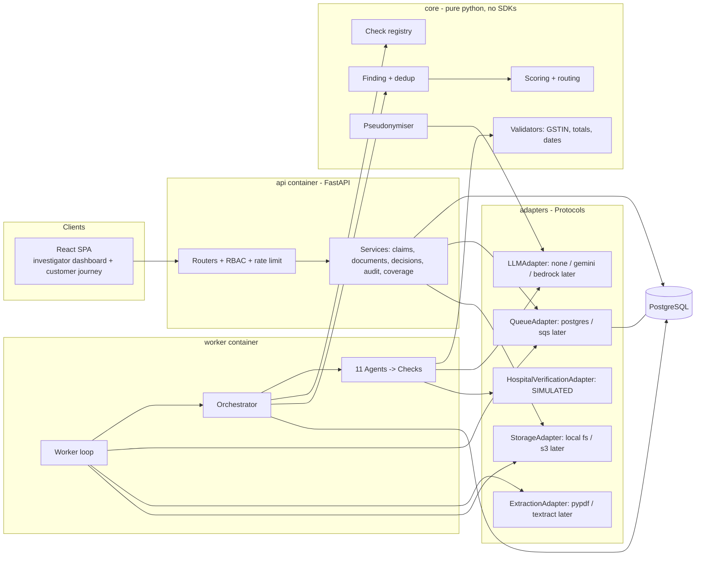
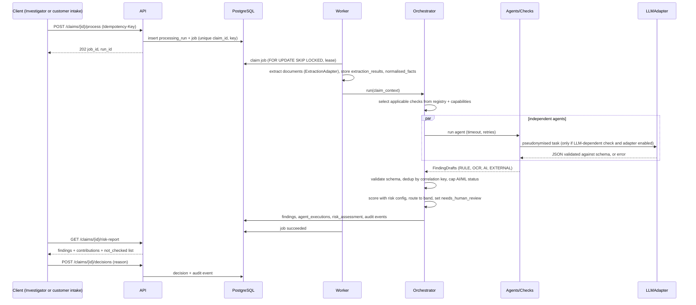
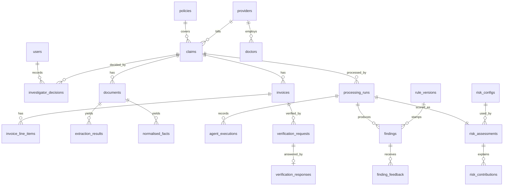

# Design Document

## Overview

ClaimShield evolves the existing `claims-fraud-detection` prototype (FastAPI, four in-memory agents, optional Gemini review, React 19 frontend) into a local-first, auditable, human-in-the-loop service. The design is incremental. The existing code is kept where it already fits (agent rule logic, Gemini HTTP client, PDF metadata parsing, seed data, document generator, SPA serving, the customer journey UI) and is moved behind new boundaries. Only the orchestrator scoring, the finding model, job tracking, persistence and authentication are replaced.

Key design decisions:

| Decision | Rationale |
|---|---|
| Pure `core` package with no I/O and no cloud SDK imports | Satisfies Requirement 2.2, makes scoring, dedup, routing and validators property-testable with Hypothesis. |
| Protocol-based adapters selected by environment variables | Requirement 2.1 and 2.3. Local, Gemini and future AWS implementations are interchangeable. |
| PostgreSQL as the only stateful dependency (data, queue, audit) | One container to run. `SELECT ... FOR UPDATE SKIP LOCKED` gives a safe multi-worker queue without Redis or a broker. |
| Check registry as the single source of truth for checks, use cases and agents | Drives orchestration, NOT_CHECKED stubs and the Coverage_Matrix. A test fails if they drift. |
| Additive, saturating risk score over deduplicated findings | Monotone, bounded, explainable. Replaces the weighted-average plus 0.8 peak rule. |
| LLM never confirms; its scored contribution is capped (changed 2026-11-21, see docs/CHANGELOG.md; Property 12 below is out of date) | Requirement 10.6. The LLM produces explanations, extracted fields and semantic comparisons that become capped POTENTIAL_ANOMALY or INCONCLUSIVE findings. |
| Findings and audit events are append-only (DB triggers plus no mutating API) | Requirements 3.6 and 17.5, 17.8. |

Research notes that informed the design:

- SQLAlchemy 2 ignores `FOR UPDATE` on SQLite, so the same queue code runs on SQLite for fast API tests and on PostgreSQL for real use ([SQLAlchemy select docs](https://docs.sqlalchemy.org/en/20/core/selectable.html#sqlalchemy.sql.expression.GenerativeSelect.with_for_update)).
- GSTIN is 15 characters: 2-digit state code, 10-character PAN, entity number, the letter `Z`, and one check character. The check character is a mod-36 weighted checksum over the first 14 characters (alphabet `0-9A-Z`, weights alternating 1 and 2, as widely documented by GSTN). Content was rephrased for compliance with licensing restrictions.
- Healthcare services are generally GST exempt in India, so a missing GSTIN is not itself an anomaly (Requirement 11.6).

## Architecture

### Component view



The API and worker share one Python package and one Docker image with different commands (`uvicorn app.main:app` and `python -m app.worker`). `docker compose up` starts `api`, `worker` and `postgres` and runs `alembic upgrade head` and the idempotent seed on API startup.

### Processing sequence



### Module layout and mapping from existing code

Target layout under `claims-fraud-detection/app/`. Legend: **KEEP** (stays in place or is lightly edited), **MOVE** (relocated, logic mostly intact), **REPLACE** (rewritten), **NEW**.

| Existing module | Fate | New location and notes |
|---|---|---|
| `main.py` (routes, SPA fallback, demo endpoints) | KEEP + split | `main.py` becomes app factory and SPA fallback. Routes move to `api/` routers. `/api/policies/lookup`, `/api/claims` (customer), `/api/claims/{id}/status`, `/api/demo/*` keep paths. `/api/internal/*` and `X-Internal-Key` are replaced by JWT auth. `/api/assess` stays but gated (Req 7.6-7.8). |
| `models.py` (Claim, Invoice, ClaimSubmission, DocumentInfo) | KEEP | Input schemas stay in `api/schemas.py`. `Finding`, `AgentResult`, `AgentTrace`, `Orchestration`, `FraudAssessment` are REPLACED by `core/finding.py` and `core/assessment.py`. |
| `orchestrator.py` | REPLACE (reuse ideas) | `core/orchestrator.py`. Keeps parallel `asyncio.gather` and agent-failure isolation. Scoring moves to `core/scoring.py`. Hardcoded `WEIGHTS`, `PEAK_FACTOR`, thresholds move to `rules/risk_scoring.v1.yaml`. |
| `jobs.py` (in-memory JOBS, customer and internal views) | REPLACE | Job state moves to `jobs` and `processing_runs` tables, the loop to `worker.py`. `customer_view` and `OUTCOMES` text move to `api/customer_view.py` with new wording. `VERIFIED_BELOW` is deleted (defect 1). |
| `agents/base.py` | REPLACE | `agents/base.py` defines `Agent` that runs registry checks. `SEVERITY_POINTS` moves to scoring config. |
| `agents/provider_profile.py` | MOVE | Rules become checks of `Provider_Intelligence`. Registry lookups go through `ProviderRepo`. |
| `agents/claimant_profile.py` | MOVE + split | `CLAIM_FREQUENCY*`, `AMOUNT_SPIKE`, `HOSPITAL_HOPPING`, `REPEATED_SIMILAR_AMOUNTS` -> `Customer_Behaviour`. `DATES_INVALID`, `LATE_SUBMISSION` -> `Policy_Eligibility`. `REPEATED_INVOICE_NUMBER` is deleted (owned by Duplicate_Detection, defect 3). |
| `agents/document_scan.py` | MOVE + fix | Metadata checks -> `Document_Forensics` with fixes for defect 9: exact producer allow-list, per-doc-type creation rule, configurable modification gap, max severity medium. `DOCUMENT_REUSED` -> `Duplicate_Detection`. `NO_DOCUMENTS` and `MISSING_*` -> `Document_Forensics` completeness check. |
| `agents/invoice_check.py` | MOVE + fix | Total, date, line-item and typical-cost rules -> `Billing_Intelligence`. `DUPLICATE_INVOICE` -> `Duplicate_Detection`. `TAX_ID_MISSING` is removed and replaced by GSTIN format and check-digit validation (defect 2). `ROUND_TOTAL` stays as INFORMATIONAL. |
| `llm.py` (Gemini client, model fallback chain, `parse_json`, `_bedrock`, `summarize`) | MOVE + split | `generate`, `gemini_models` fallback chain and `parse_json` -> `adapters/llm/gemini.py`. `_bedrock` is deleted from core (later `adapters/llm/bedrock.py` in the `aws` extra). `run_tool_loop` is deleted (the LLM must not fetch data or move scores). `summarize` -> `LLMAdapter.explain`. |
| `llm_review.py` | REPLACE | Today the LLM adds score points and sees the full claim (defects 5, Req 10). Replaced by `core/llm_tasks.py` with typed, pseudonymised tasks and JSON schemas. |
| `catalog.py` | REPLACE | Agent catalog is generated from the registry and Coverage_Matrix. |
| `config.py` (`load_env`) | REPLACE | `settings.py` using pydantic-settings, fails fast naming missing variables (Req 1.6). `.env` is still read in dev. |
| `data/store.py` (in-memory hospitals, doctors, policies, history, SEEN_*) | MOVE | Data becomes `seed/seed_data.py` used by `seed/run.py` to populate tables. In-memory accessors are replaced by repositories. |
| `docgen.py` | KEEP | Moves to `seed/docgen.py`; generates synthetic PDFs for seeded scenarios and tests. |
| `scripts/*`, `demo.py` | KEEP | Updated to log in and call new endpoints. |
| `requirements.txt` | EDIT | Adds sqlalchemy, alembic, psycopg, pydantic-settings, argon2-cffi, pyjwt, pyyaml, hypothesis, pytest. `boto3` moves to `pyproject.toml` extra `aws`. |

New packages: `core/` (pure), `adapters/`, `db/` (SQLAlchemy models, session, repositories, `alembic/`), `api/`, `worker.py`, `rules/` (YAML), `seed/`.

```text
app/
  main.py  settings.py  worker.py
  api/        auth.py claims.py documents.py processing.py findings.py decisions.py
              audit.py admin.py customer.py schemas.py deps.py errors.py
  core/       finding.py dedup.py scoring.py routing.py orchestrator.py registry.py
              coverage.py pii.py llm_tasks.py validators/{gstin.py,totals.py,dates.py}
  agents/     base.py policy_eligibility.py duplicate_detection.py document_forensics.py
              medical_consistency.py billing_intelligence.py provider_intelligence.py
              customer_behaviour.py identity_verification.py hospitalisation.py
              predictive_fraud.py operational_intelligence.py
  adapters/   llm/{base,none,gemini}.py  extraction/{base,pypdf_ext}.py
              storage/{base,local_fs}.py  queue/{base,postgres}.py  hospital/{base,simulated}.py
  db/         models.py session.py repos.py alembic/
  rules/      risk_scoring.v1.yaml  coverage_matrix.v1.yaml  reference_ranges.v1.yaml
  seed/       seed_data.py docgen.py run.py
```

## Components and Interfaces

### Adapters

All adapters are `typing.Protocol` classes in `adapters/<name>/base.py`. A factory in `adapters/__init__.py` reads `LLM_ADAPTER`, `EXTRACTION_ADAPTER`, `STORAGE_ADAPTER`, `QUEUE_ADAPTER`, `HOSPITAL_ADAPTER` and imports the implementation lazily, so a cloud SDK is only imported when selected. A contract test suite (`tests/contract/`) is parametrised over implementations (Req 2.6). Adapter errors derive from `AdapterError`; orchestrator maps them to INCONCLUSIVE (Req 2.5).

```python
class LLMAdapter(Protocol):
    name: str
    enabled: bool                                   # False for 'none'
    def extract_fields(self, task: ExtractFieldsTask) -> ExtractedFields: ...
    def compare_fields(self, task: CompareFieldsTask) -> FieldComparison: ...
    def explain(self, task: ExplainTask) -> str: ...  # summarisation / explanation only

class ExtractionAdapter(Protocol):
    def extract(self, data: bytes, content_type: str) -> ExtractionOutput: ...  # pages[], text, fields[], metadata

class StorageAdapter(Protocol):
    def put(self, data: bytes, content_type: str) -> str: ...   # returns generated storage_key
    def get(self, storage_key: str) -> bytes: ...
    def delete(self, storage_key: str) -> None: ...

class QueueAdapter(Protocol):
    def enqueue(self, kind: str, payload: dict, dedupe_key: str | None = None) -> str: ...
    def lease(self, worker_id: str, lease_seconds: int) -> Job | None: ...
    def complete(self, job_id: str) -> None: ...
    def fail(self, job_id: str, error: str, retry_in: int | None) -> None: ...

class HospitalVerificationAdapter(Protocol):
    simulated: bool
    def verify_invoice(self, req: VerificationRequest) -> VerificationResponse: ...
```

- `NoneLLM`: `enabled=False`. LLM-dependent checks see `capabilities` without `llm` and emit NOT_CHECKED (Req 1.7).
- `GeminiLLM`: wraps the existing `generate()` with its model fallback chain and `parse_json`. Each task has a Pydantic output model; output is validated with `model_validate_json`; failure raises `LLMOutputInvalid` (Req 10.3-10.4). Document text goes inside a delimited block, with a system instruction that the block is data only (Req 10.2). Requires `GEMINI_API_KEY`, which is present in the git-ignored `.env` for dev.
- `PostgresQueue`: table `jobs`. `lease` runs `SELECT ... WHERE status='queued' AND run_after<=now() ORDER BY created_at FOR UPDATE SKIP LOCKED LIMIT 1`, sets `status='leased'`, `lease_expires_at`, `attempts+1`. A reaper requeues expired leases.
- `SimulatedHospitalVerification`: deterministic by seeded hospital flags (confirms, no result, or pending). Every response carries `simulated=true`.
- `PypdfExtraction`: reuses pypdf already used by `document_scan.py`. Returns text per page and PDF metadata. Image-only files return empty text, which yields INCONCLUSIVE "no extractable text" (Req 9.5).

### Check registry and agents

```python
@dataclass(frozen=True)
class CheckSpec:
    check_id: str                  # e.g. "POL-DATE-WINDOW"
    agent: AgentName               # one of 11
    use_case_ids: tuple[int, ...]
    priority: Literal["P0", "P1", "P2"]
    method: DetectionMethod
    requires: frozenset[Capability]        # e.g. {"policy"}, {"llm"}, {"image_analysis"}
    rule_version: str
    fn: Callable[[CheckContext], list[FindingDraft]] | None   # None => stub

def check(**spec): ...             # decorator registering an implemented check
def stub(check_id, agent, use_case_ids, requires, limitation): ...   # registers NOT_CHECKED-only check
```

`CheckContext` is an immutable snapshot assembled by the worker before agents run: claim, policy, invoice facts, normalised facts, document extraction results, repository read views (history, provider baselines), reference ranges, and the set of available `Capability` values. Checks are sync and pure over the context, so they are deterministic and unit-testable. Adapter calls (LLM, hospital verification) happen in checks that declare `requires={"llm"}` or `{"hospital_verification"}` and receive the adapter in the context.

Agent execution: `Agent.run(ctx)` iterates its registered checks. For each check, if `requires - ctx.capabilities` is non-empty the agent emits one NOT_CHECKED finding per use case with the reason `missing capability: <name>` and the limitation text from the registry. Otherwise it runs `fn`. Exceptions in a check create an INCONCLUSIVE finding with the error class name and do not fail the agent.

MVP implementations by agent (P0). Exact use-case ids are written into the YAML and registry in the same change; ids stated in the requirements are shown.

| Agent | Implemented checks (rules) | Stubs (NOT_CHECKED or INCONCLUSIVE) |
|---|---|---|
| Policy_Eligibility (UC 1-12) | policy window, waiting period, exclusions, sum insured, insured person, purchase-to-admission gap (configurable days, POTENTIAL_ANOMALY), date sanity, late submission | UC 3 pre-existing disease: INCONCLUSIVE or NOT_CHECKED without medical history |
| Duplicate_Detection (UC 13-22) | exact invoice key (provider, number, date, amount), fuzzy resubmission with differing-fields list, document SHA-256 reuse, cashless vs reimbursement, cross-claim/family match. Excludes the claim's own earlier runs | UC 22 cross-insurer: NOT_CHECKED, data sharing not available |
| Document_Forensics (UC 23-38) | producer allow-list, creation/modification metadata with per-type rules, completeness, cross-document exact-field comparison, extraction quality | UC 30, 31 signatures and stamps: NOT_CHECKED without `image_analysis`. LLM semantic comparison requires `llm` |
| Billing_Intelligence (UC 51-65) | GSTIN format and check digit, GST-exempt categories, total recomputation, claimed vs invoice, pre-auth overrun, reference ranges, stay length, line-item sanity | Categories without reference ranges: NOT_CHECKED |
| Provider_Intelligence | hospital registry, doctor licence and affiliation, provider claim-volume surge (UC 65) | none |
| Customer_Behaviour | claim frequency, amount spike, hospital hopping, repeated similar amounts | none |
| Operational_Intelligence (UC 115-122) | post-submission change, approval without required documents (118, 122), override and resubmission patterns from ops records | checks lacking ops data: NOT_CHECKED |
| Medical_Consistency, Identity_Verification, Hospitalisation, Predictive_Fraud | none in MVP beyond stubs for their P0 use cases (if any) | Registered so the 11 agents exist and the matrix is complete. Their P1/P2 use cases are "planned" in the matrix |

Every P0 use case has at least one registry entry (implemented or stub). A test asserts this.

### Orchestrator

`core/orchestrator.py` exposes `async def assess(ctx, registry, config, adapters) -> Assessment` with no DB access; the worker persists the result. Responsibilities map to Requirement 4:

1. Select applicable checks by capability (4.1).
2. Run agents with `asyncio.gather`. Blocking work runs via `asyncio.to_thread` as the current code does (4.2).
3. Wrap each agent with `asyncio.wait_for(timeout)` and retry up to `AGENT_RETRIES`. On final timeout, emit INCONCLUSIVE findings for that agent's checks (4.4). Each attempt is returned as an `AgentExecution` record (4.3).
4. Validate each `FindingDraft` against the schema. Invalid output is discarded and recorded as an `AgentExecution.error` (4.5).
5. Cap AI or ML findings at POTENTIAL_ANOMALY, then deduplicate (4.6), score, route (Req 5).
6. Set `needs_human_review=true` if any INCONCLUSIVE exists and the band is low (4.7).
7. The result type has `recommended_queue` and `needs_human_review` only. It has no decision field, so a denial or rejection is unrepresentable (4.8). Claim status after processing is one of `ASSESSED`, `NEEDS_HUMAN_REVIEW` or `OPEN_INVESTIGATION`.

Idempotency (4.9): `processing_runs` has a unique index on `(claim_id, idempotency_key)`. The service does `INSERT ... ON CONFLICT DO NOTHING` and returns the existing run.

### Finding, dedup, scoring, routing

```python
class FindingStatus(StrEnum): CONFIRMED_RULE_VIOLATION; POTENTIAL_ANOMALY; INFORMATIONAL; NOT_CHECKED; INCONCLUSIVE
class FindingDraft(BaseModel):          # produced by checks
    use_case_id: int; check_id: str; agent: AgentName; category: str
    severity: Literal["low","medium","high"]; status: FindingStatus
    explanation: str; source_document_id: UUID | None; page: int | None; source_field: str | None
    extracted_values: dict; expected_value: dict | str | None
    method: DetectionMethod; confidence: float | None; confidence_definition: str
    limitations: list[str]; alternatives: list[str]; next_action: str
    fact_key: FactKey                    # (fact_type, subject, normalised values)
class Finding(FindingDraft):             # persisted, immutable
    finding_id: UUID; claim_id: UUID; run_id: UUID; created_at: datetime; rule_version: str
    correlation_key: str; contributing_checks: list[str]; contributing_sources: list[str]
```

- Correlation key = `sha256(fact_type | canonical_json(subject) | canonical_json(normalised_values))`. `fact_type` examples: `invoice_duplicate`, `gstin_invalid`, `invoice_total`, `claim_date_window`. Duplicate invoice, repeated invoice number and duplicate tax id all share `fact_type=invoice_duplicate` per matched claim, so they merge (defect 3).
- `dedup(findings)`: group by correlation key, keep the member with highest `(status_rank, severity_rank)`, union `contributing_checks` and sources and `use_case_id`s. It is deterministic and order independent. NOT_CHECKED findings use `fact_key=("not_checked", check_id)` so they do not collapse into real facts.
- `score(findings, config)`: contribution = `severity_points[severity] * status_multiplier[status]` for statuses in `config.scored_statuses` (CONFIRMED_RULE_VIOLATION, POTENTIAL_ANOMALY). NOT_CHECKED, INFORMATIONAL and INCONCLUSIVE contribute 0 and are listed separately (Req 5.3). `score = min(100, round(sum, 1))`. Returns the per-finding contributions for storage.
- `route(score, bands)`: `score < review_at -> low`, `< investigate_at -> manual_review`, else `investigate`. Defaults 30 and 60. Config validation: `0 < review_at < investigate_at <= 100`.

`rules/risk_scoring.v1.yaml`:

```yaml
version: "risk-2025.1"
label: "Ordering signal, not a probability"
severity_points: {low: 10, medium: 25, high: 45}
status_multiplier: {CONFIRMED_RULE_VIOLATION: 1.0, POTENTIAL_ANOMALY: 0.6}
bands: {review_at: 30, investigate_at: 60}
thresholds:
  policy_purchase_gap_days: 30
  preauth_overrun_pct: 10
  invoice_total_tolerance: 1.00
  doc_modification_gap_hours: {invoice: 24, discharge_summary: 72, default: 48}
  provider_volume_multiple: 3.0
gst_exempt_categories: [inpatient_room, consultation, nursing, diagnostics]
```

An Administrator threshold change writes a new row in `risk_configs` (new version, previous kept) and an audit event; later assessments use the active version, earlier `risk_assessments` keep their `config_version` (Req 5.7-5.8). The YAML is the seed of version 1; edits through `PUT /admin/risk-config` create new DB versions.

### LLM tasks, PII and prompt-injection safety

- `core/pii.py` builds `Pseudonymiser(claim)` mapping claimant name, family names, policy number, phone, email, address, DOB, and ids to stable tokens (`CLAIMANT_A`, `POLICY_1`). It also scrubs those literal values (case-insensitive, normalised) from document text before it enters a task.
- Each task class has an allow-list of fields. `build_payload(task)` can only serialise those fields; it does not accept a `Claim`. Amounts, dates as offsets from admission, and categorical values are allowed.
- Prompt layout: system rules, then `<<<DOCUMENT_DATA ... DOCUMENT_DATA>>>` data block, with an instruction that its content is never instructions. Output must match the task JSON schema.
- On invalid output or adapter error, the check yields INCONCLUSIVE and the claim keeps its rules-only findings (Req 10.4).
- LLM-derived findings use method `AI`, are capped at POTENTIAL_ANOMALY, and never reach CONFIRMED. The score and band are computed by the same function with the same inputs, so adding LLM text cannot change the rule findings (Req 10.6-10.7).
- `llm_calls` audit rows store prompt Rule_Version, adapter name and field names sent, no values (Req 10.8).

### Validators (pure functions in `core/validators/`)

- `gstin.is_valid(s)`, `gstin.check_char(first14)`: format regex, state code 01-38 and 97, `Z` at position 14, mod-36 check character.
- `totals.recompute(line_items) -> Decimal`, `totals.differs(stated, computed, tolerance)`: all arithmetic in `Decimal`.
- `dates.in_window(d, start, end)`, `preauth.overrun(final, preauth, pct)`.

### API layer, authentication and RBAC

- Passwords: argon2id via `argon2-cffi`. Login `POST /api/auth/login` returns a short-lived JWT (PyJWT, HS256, 30 minutes, claims `sub`, `role`, `jti`). `JWT_SECRET` is required. Chosen over sessions because the SPA and scripts both call the API and there is no server session store to maintain.
- `deps.require_roles(*roles)` FastAPI dependency. Missing or invalid token gives 401; wrong role gives 403 plus an audit `access_denied` event (Req 6.3, 17.4).
- Public routes: `/api/health`, customer intake routes (`/api/policies/lookup`, `POST /api/claims` customer, `GET /api/claims/{id}/status`, `/api/demo/*`). Everything else needs auth.
- Rate limit on `/api/policies/lookup`: in-process sliding window keyed by client IP and by policy number (`LOOKUP_RATE=5/minute`), returns 429. This is enough for one API container; a shared store is a later change.
- `POST /api/assess` is limited to Investigator, Fraud_Team and Administrator, runs the same policy checks as processing, and only persists when `?test_mode=true` is passed and then labels the claim `is_test=true`.
- Customer intake ignores any client-supplied analysis flags (`use_llm` is deleted from the form). A policy eligibility violation returns HTTP 422 to the customer and also stores the claim with the Finding for review (Req 8.6).

### Customer-facing wording

`api/customer_view.py` returns an outcome title and message plus check labels limited to "No issues found", "Verification unavailable" or "SIMULATED". It never includes findings, scores, bands or the words verified, genuine or authentic unless an authoritative non-simulated source confirmed the fact (none exists locally). The current `OUTCOMES` text "passed all automated checks" is reworded to "received" language.

### Frontend changes

| Existing | Change |
|---|---|
| `pages/internal/InternalPage.tsx` | Becomes the Investigator dashboard shell with login and role-aware nav. Header key `X-Internal-Key` replaced by Bearer token in `api.ts`. |
| `ClaimsView.tsx` | Claims queue with filters (band, status, provider, dates, assignee, category). |
| `ClaimDetail.tsx` | Claim workspace: document viewer with page navigation, extracted fields beside source, comparison table, authenticity panel, grouped findings, score contributions, decision panel, audit trail. Seven sections of Req 18.4 as tabs. |
| `WorkflowView.tsx` | Processing run timeline from `agent_executions`. |
| `AgentsView.tsx` | Coverage view (Administrator only), from `/api/coverage-matrix`. |
| `components/ui.tsx` | Reused. Add `StatusBadge` for the five Finding_Statuses (NOT_CHECKED is grey with its limitation, never green). |
| `ProcessingPage.tsx`, `ReportPage.tsx`, `journey/*` | Kept as customer intake. `ReportPage` wording follows the customer view above. |
| `api.ts` | Token storage, 401 redirect to login, typed responses for new endpoints. |

### Coverage_Matrix

`rules/coverage_matrix.v1.yaml` has `version` and 126 entries:

```yaml
- use_case_id: 13
  title: Exact duplicate invoice
  priority: P0
  agent: Duplicate_Detection
  data_required: [invoices]
  method: RULE
  dependencies: []
  evidence: [invoice_number, provider_id, invoice_date, amount]
  limitations: []
  status: implemented        # implemented | not_implemented_locally | planned
  blocked_by: null           # e.g. "cross-insurer data sharing"
  check_ids: [DUP-EXACT-INVOICE]
```

`core/coverage.py` joins the YAML with the registry. A consistency test enforces: 126 unique ids; P0 exactly 1-38, 51-65, 115-122; `status=implemented` iff at least one non-stub check maps to the use case and a test is tagged with that `check_id` (pytest marker `@pytest.mark.check_id("...")`, collected in `conftest.py`); P1 and P2 are `planned`; stub-only P0 are `not_implemented_locally` with `blocked_by` (Req 19.4-19.6).

## Data Models

Primary keys are UUIDv4 (Req 16.5). Alembic manages migrations. JSON columns use `JSON` with `JSONB` variant on PostgreSQL so models run on SQLite in tests.



| Table | Key columns |
|---|---|
| `users` | id, username (unique), password_hash, role (Investigator, Ops_Manager, Fraud_Team, Administrator), is_active |
| `policies` | id, policy_number (unique), plan, inception_date, expiry_date, sum_insured, waiting_period_days, exclusions JSON, dob (needed for lookup only) |
| `members` | id, policy_id, name, relation, dob. Member references only; name used only where checks need it |
| `providers` | id, code, name, city, registered, years_active, avg_claim, std_claim, flagged_claims_ratio, baseline_monthly_claims, gstin, reference_source |
| `doctors` | id, provider_id, name, licence_valid, specialities |
| `claims` | id, policy_id, member_id, provider_id, doctor_id, disease_code, admission_date, discharge_date, claimed_amount, submitted_on, channel (investigator or customer), status, is_test, preauth_amount, retention_until, created_at |
| `claim_changes` | id, claim_id, field, before JSON, after JSON, changed_by, changed_at (UC 120) |
| `documents` | id, claim_id, doc_type, storage_key, sha256, content_type, size, original_name_ref, uploaded_at. Unique `(claim_id, sha256)` (Req 9.7) |
| `extraction_results` | id, document_id, adapter, page, text, fields JSON, metadata JSON |
| `normalised_facts` | id, claim_id, document_id, field, original_value, normalised_value, page, source_field |
| `invoices` | id, claim_id, document_id, invoice_number, invoice_date, gstin, stated_total, service_category, authenticity_state |
| `invoice_line_items` | id, invoice_id, description, amount, category |
| `processing_runs` | id, claim_id, idempotency_key, retry_of_run_id, status, rule_version, config_version, started_at, finished_at. Unique `(claim_id, idempotency_key)` |
| `jobs` | id, kind, payload JSON, status, attempts, max_attempts, run_after, lease_expires_at, leased_by, last_error, dedupe_key |
| `agent_executions` | id, run_id, agent, state, attempt, started_at, ended_at, error |
| `findings` | id, claim_id, run_id, use_case_id, check_id, category, agent, severity, status, explanation, source_document_id, page, source_field, extracted_values JSON, expected_value JSON, method, confidence, confidence_definition, limitations JSON, alternatives JSON, next_action, correlation_key, contributing_checks JSON, rule_version, created_at. DB trigger blocks UPDATE and DELETE |
| `risk_configs` | id, version (unique), body JSON, created_by, created_at, is_active |
| `risk_assessments` | id, run_id, claim_id, score, band, needs_human_review, config_version, rule_version, label |
| `risk_contributions` | assessment_id, finding_id, points, scored (bool), reason |
| `verification_requests` / `verification_responses` | id, invoice_id, adapter, simulated, request JSON/response JSON, timestamps, state |
| `investigator_decisions` | id, claim_id, user_id, decision, reason, notes, risk_assessment_id, created_at |
| `finding_feedback` | id, finding_id, user_id, verdict (false_positive or confirmed), rule_version, created_at |
| `llm_calls` | id, run_id, adapter, prompt_version, field_names JSON, outcome, created_at |
| `rule_versions` | id, kind (rules, prompt, scoring), version, checksum |
| `audit_events` | id, seq (bigserial), ts, actor_id, event_type, entity_type, entity_id, request_id, detail JSON (no PII), prev_hash, hash. Trigger blocks UPDATE and DELETE |

Audit hash: `hash = sha256(prev_hash || canonical_json(ts, actor_id, event_type, entity_type, entity_id, request_id, detail))`. Inserts take `pg_advisory_xact_lock` so the chain is linear. `verify_chain(events)` is a pure function returning the first mismatching `seq` or `None`.

Retention: a nightly `retention` job deletes or anonymises PII and documents past `retention_until` and writes an audit event (Req 17.3). Structured logs use `structlog` with request id, user id and event type only; no PII or document content (Req 17.7).

Claim status values: `RECEIVED`, `PROCESSING`, `ASSESSED`, `NEEDS_HUMAN_REVIEW`, `OPEN_INVESTIGATION`, `DECIDED`, `FAILED`. Only the decision service moves a claim to `DECIDED`. Claims in band `investigate` stay `OPEN_INVESTIGATION` until a decision exists (Req 6.5).

### API endpoints

All JSON. Errors use the envelope in Error Handling. Roles: I = Investigator, F = Fraud_Team, O = Ops_Manager, A = Administrator.

| Method and path | Roles | Purpose |
|---|---|---|
| `GET /api/health` | public | Health (DB, queue, adapters) |
| `POST /api/auth/login` | public | Returns JWT |
| `GET /api/me` | any | Current user and role |
| `POST /api/policies/lookup` | public, rate limited | Customer policy lookup |
| `POST /api/claims` (multipart) | public (customer intake) | Create claim and upload documents, returns 202 and job id |
| `GET /api/claims/{id}/status` | public | Customer-safe status |
| `POST /api/internal/claims` | I, F, A | Create claim (investigator channel) |
| `GET /api/internal/claims` | I, F, O, A | Queue with filters: band, status, provider, date range, assignee, category |
| `GET /api/internal/claims/{id}` | I, F, O, A | Claim detail |
| `POST /api/claims/{id}/documents` | I, F, A | Upload (allow-list, size, SHA-256) |
| `GET /api/claims/{id}/documents`, `GET /api/documents/{id}`, `GET /api/documents/{id}/pages/{n}` | I, F, O, A | List, retrieve, page view (audited) |
| `POST /api/claims/{id}/process` | I, F, A | Header `Idempotency-Key`; returns 202 `{job_id, run_id}` |
| `POST /api/claims/{id}/runs/{run_id}/retry` | I, F, A | New run linked via `retry_of_run_id` |
| `GET /api/jobs/{id}` | I, F, O, A | Job status |
| `GET /api/documents/{id}/extraction` | I, F, A | Extraction_Results and Normalised_Facts |
| `GET /api/claims/{id}/findings` | I, F, A (all but Operational); O, F, A (Operational findings) | Findings; Operational_Intelligence findings are filtered out for Investigator (Req 15.9) |
| `GET /api/claims/{id}/risk-report` | I, F, O, A | Score, band, contributions, not_checked list, config and rule versions, label |
| `GET /api/claims/{id}/invoices/{inv}/authenticity` | I, F, A | Invoice_Authenticity_State and verification requests |
| `POST /api/claims/{id}/decisions` | I, F | Decision with reason and notes; 403 otherwise |
| `POST /api/findings/{id}/feedback` | I, F | false_positive or confirmed |
| `GET /api/claims/{id}/audit` | I, F, A | Audit history for claim |
| `GET /api/admin/audit/verify` | A | Integrity check, first bad seq or intact |
| `GET/PUT /api/admin/risk-config` | A (PUT), A and F (GET) | Versioned bands and weights |
| `GET/POST/PUT /api/providers` | F, A | Provider reference data |
| `GET /api/coverage-matrix` | A, F | Versioned matrix joined with registry |
| `POST /api/assess` | I, F, A | Direct assessment (gated, see above) |
| `GET /api/demo/{kind}` | public | Seeded demo case helper kept from current code |

OpenAPI is generated by FastAPI; each route declares `responses` for 401, 403, 422, 429 and its role in the description (Req 16.1).

## Correctness Properties

*A property is a characteristic or behavior that should hold true across all valid executions of a system-essentially, a formal statement about what the system should do. Properties serve as the bridge between human-readable specifications and machine-verifiable correctness guarantees.*

### Property 1: Score is bounded, deterministic and explained

*For any* list of findings and any valid risk configuration, the score is in [0, 100], equals `min(100, sum of stored contributions)` rounded to one decimal, and is identical when computed twice on the same input.

**Validates: Requirements 5.1, 5.2, 5.5**

### Property 2: Score is monotone in added evidence

*For any* findings list and any additional scored finding (CONFIRMED_RULE_VIOLATION or POTENTIAL_ANOMALY) with a new correlation key, the new score is greater than or equal to the old score. *For any* finding whose severity is raised, the score does not decrease.

**Validates: Requirements 5.1, 5.4**

### Property 3: Unscored statuses never change the score

*For any* findings list and any set of added findings whose status is NOT_CHECKED, INFORMATIONAL or INCONCLUSIVE, the score and the contribution list of scored findings are unchanged, and the added findings appear in the separate not-scored list.

**Validates: Requirements 5.3**

### Property 4: Deduplication is idempotent, order independent and counts a fact once

*For any* list of findings with arbitrary correlation keys, `dedup(dedup(xs)) == dedup(xs)`, `dedup` of any permutation of `xs` gives the same result, each correlation key appears once, `contributing_checks` is the union over the group, and `score(xs) == score(dedup(xs))`.

**Validates: Requirements 4.6, 5.4, 12.5**

### Property 5: Routing is total and respects band boundaries

*For any* score in [0, 100] and any valid bands with `0 < review_at < investigate_at <= 100`, `route` returns exactly one band; scores below `review_at` are low, scores from `review_at` up to but excluding `investigate_at` are manual_review, scores at or above `investigate_at` are investigate; and a higher score never maps to a lower band. With defaults, 29.9 is low, 30.0 is manual_review, 59.9 is manual_review and 60.0 is investigate.

**Validates: Requirements 5.6**

### Property 6: Risk configuration round trip and validation

*For any* valid risk configuration, serialising to YAML and parsing it yields an equal configuration, and *for any* bands that violate `0 < review_at < investigate_at <= 100` loading fails with a validation error.

**Validates: Requirements 5.1, 5.6, 5.7**

### Property 7: AI and ML findings are capped

*For any* finding draft with method AI or ML and any proposed status, the normalised status is POTENTIAL_ANOMALY, INFORMATIONAL, NOT_CHECKED or INCONCLUSIVE and never CONFIRMED_RULE_VIOLATION. *For any* draft, exactly one status is assigned.

**Validates: Requirements 3.2, 3.3, 10.6**

### Property 8: No silent pass (registry totality)

*For any* subset of capabilities, running all registered checks yields, for each registered check and use case, either the output of the check or a NOT_CHECKED finding that names the missing capability and the limitation. No registered P0 use case is absent from the result.

**Validates: Requirements 1.7, 3.4, 11.8, 12.6, 13.9**

### Property 9: Orchestrator never emits deny or reject

*For any* set of agent outputs, including failures, timeouts and invalid drafts, the orchestrator outcome contains only a recommended queue from the three bands and a human-review flag, and the claim status it sets is one of ASSESSED, NEEDS_HUMAN_REVIEW, OPEN_INVESTIGATION or FAILED.

**Validates: Requirements 4.8**

### Property 10: Inconclusive findings on a low band force human review

*For any* findings list, `needs_human_review` is true if and only if at least one finding is INCONCLUSIVE and the routed band is low.

**Validates: Requirements 4.7**

### Property 11: Processing is idempotent per key

*For any* claim, key and number of submissions n >= 1 with that key, exactly one processing run exists and every response returns that run identifier.

**Validates: Requirements 4.9**

### Property 12: LLM output cannot change score, band or confirmed findings

*For any* claim and *for any* LLM adapter output (schema-valid, schema-invalid, empty, or text containing instructions) and any injected instruction text appended to document text, the rule findings, score and band equal the rules-only result, no AI finding is CONFIRMED_RULE_VIOLATION, and invalid output yields INCONCLUSIVE for the affected AI check.

**Validates: Requirements 10.3, 10.4, 10.6, 10.7, 20.5**

### Property 13: PII never appears in an LLM payload or LLM call record

*For any* claim with generated PII values (claimant and family names, policy number, phone, email, date of birth) and any document text that embeds those values, the serialised LLM payload and the stored `llm_calls` record contain none of the values.

**Validates: Requirements 10.1, 10.8**

### Property 14: GSTIN check character round trip

*For any* 14-character base string of valid format, appending `check_char(base)` gives a GSTIN that `is_valid` accepts, and *for any* single-character substitution at any position that keeps the format valid, `is_valid` rejects it.

**Validates: Requirements 11.5**

### Property 15: Missing GSTIN is not an anomaly for exempt categories

*For any* invoice whose service category is in the configured GST-exempt list and which has no GSTIN, Billing_Intelligence returns no GSTIN finding.

**Validates: Requirements 11.6**

### Property 16: Invoice totals are recomputed exactly

*For any* list of line items with Decimal amounts and any stated total and tolerance, a CONFIRMED_RULE_VIOLATION total finding is produced if and only if `abs(stated - sum(items)) > tolerance`, and the finding lists both values.

**Validates: Requirements 11.7**

### Property 17: Policy date and pre-authorisation rules

*For any* claim date, inception, expiry, purchase date, admission date, pre-authorised amount, final bill and thresholds: a window violation exists iff the claim date is outside `[inception, expiry]`; a purchase-gap POTENTIAL_ANOMALY exists iff the gap is below the configured days; a pre-authorisation finding exists iff `final > preauth * (1 + pct/100)`.

**Validates: Requirements 11.2, 11.3, 11.4**

### Property 18: Duplicate detection finds each match once and never matches itself

*For any* set of stored invoices and a new invoice with the same provider, number, date and amount as k >= 1 stored invoices from other claims, Duplicate_Detection emits exactly one finding referencing all k claims and documents; when the stored invoice belongs to the same claim, no finding is emitted; and *for any* resubmission that differs in amount or date only, the finding lists exactly the differing fields.

**Validates: Requirements 12.2, 12.3, 12.7**

### Property 19: Forensics indicators are exact, low severity and never confirmed

*For any* PDF producer string, the editor-software check fires only when the string equals an allow-listed name exactly (so `"Microsoft Word"` substrings such as `"password manager"` do not match); *for any* metadata values, creation and modification dates and document type, every metadata finding has severity low or medium and status POTENTIAL_ANOMALY, no finding is CONFIRMED_RULE_VIOLATION, and prescriptions and pre-admission reports produce no creation-before-admission finding.

**Validates: Requirements 13.2, 13.3, 13.4, 13.5, 20.4**

### Property 20: Cross-document mismatch preserves both values

*For any* set of documents with a perturbed value in one of patient name, date, amount or invoice number, the comparison yields a finding containing both the original and the normalised values of the differing fields, and *for any* set with identical normalised values it yields none.

**Validates: Requirements 13.6**

### Property 21: Invoice authenticity state is a single, ordered function of its inputs

*For any* combination of hospital verification result, provider identity match, outstanding request and invoice findings, exactly one Invoice_Authenticity_State is returned; medium-or-higher forensic or duplicate findings give "Potential manipulation indicators"; and every state derived from the simulated adapter is labelled SIMULATED.

**Validates: Requirements 14.1, 14.2, 14.3, 14.4, 14.5, 14.6, 14.7**

### Property 22: Reference range and volume thresholds

*For any* charge, reference range and baseline multiple, a POTENTIAL_ANOMALY exists iff the charge exceeds the range maximum (and cites range and source); when no range exists the check is NOT_CHECKED; a provider volume finding exists iff period volume exceeds multiple times baseline.

**Validates: Requirements 15.2, 15.4, 15.5**

### Property 23: Upload validation, checksum and storage key independence

*For any* byte string and any client file name, the stored checksum equals SHA-256 of the bytes; the storage key does not contain the file name; uploading the same bytes to the same claim n times yields one document; and `StorageAdapter.get(put(x)) == x`.

**Validates: Requirements 9.1, 9.3, 9.7**

### Property 24: Decision authorisation and reason

*For any* user role, decision value and reason string, a decision is accepted iff the role is Investigator or Fraud_Team and the reason has at least one non-whitespace character; otherwise it is rejected with forbidden or validation error, an access denial writes an audit event, and no decision row is stored.

**Validates: Requirements 6.1, 6.2, 6.3**

### Property 25: Lookup rate limiting

*For any* sequence of lookup attempts with timestamps, attempts beyond the configured rate within the window for the same client or the same policy number are rejected, and attempts within the rate are accepted.

**Validates: Requirements 7.9**

### Property 26: Customer view never leaks findings or unearned verification wording

*For any* assessed claim, the customer view contains no finding codes, scores, bands or agent names, every check label is one of "No issues found", "Verification unavailable" or "SIMULATED", and no text contains "verified", "genuine" or "authentic" unless a non-simulated authoritative confirmation exists.

**Validates: Requirements 8.3, 8.4, 8.5**

### Property 27: Audit chain integrity

*For any* sequence of audit events, `verify_chain` reports intact; and *for any* modification of one event's content, deletion of one event, or reordering of two events, `verify_chain` reports the index of the first affected event.

**Validates: Requirements 17.5, 17.6**

## Error Handling

All errors use one envelope: `{"error": {"code": "...", "message": "...", "fields": [{"name": "...", "reason": "..."}], "request_id": "..."}}`.

| Situation | Behaviour |
|---|---|
| Schema validation failure | 422 with failing field names (Req 16.3). Pydantic errors are mapped to the envelope |
| Missing or invalid token | 401. Wrong role: 403 plus `access_denied` audit event |
| Rate limit exceeded | 429 with `Retry-After` |
| Upload type, size or content invalid | 422 naming the rule; nothing stored (Req 9.2) |
| Policy eligibility violation on customer intake | 422 to customer, claim stored with Finding for review (Req 8.6) |
| Missing environment variable at startup | Process exits non-zero, message names the variable, never prints the value (Req 1.6) |
| Adapter error or timeout | `AdapterError` recorded in `agent_executions.error`; dependent checks INCONCLUSIVE; other checks continue (Req 2.5) |
| Agent timeout | Retried up to `AGENT_RETRIES`, then INCONCLUSIVE findings |
| Invalid LLM JSON or schema | Output discarded, AI checks INCONCLUSIVE, rules-only result used |
| Invalid agent output | Discarded and recorded; the check yields INCONCLUSIVE |
| Check raises | INCONCLUSIVE finding with exception class name only (no document content) |
| Worker crash mid-job | Lease expires, job requeued until `max_attempts`, then the run is `FAILED` and the claim `NEEDS_HUMAN_REVIEW` |
| Duplicate processing request with same key | 202 returning the existing run (not an error) |
| Retry after failure | New run with `retry_of_run_id` (Req 16.4) |
| Unexpected exception in API | 500 with request id only; details to structured log without PII |

An INCONCLUSIVE or failed run never produces a "clean" outcome: the claim is flagged for human review (Req 4.7).

## Testing Strategy

PBT applies to the core: scoring, dedup, routing, validators, PII payload building, authenticity state, audit chain, rate limiter and rule checks, all pure functions with large input spaces. It does not apply to Docker Compose setup, DB triggers, the React UI and adapter wiring; those use smoke, integration and example tests.

**Libraries and layout**

- `pytest`, `hypothesis` for properties, `pytest-asyncio`, FastAPI `TestClient`, `freezegun` or an injected clock.
- Core tests need no DB. API and repository tests use SQLite in-memory by default (SQLAlchemy skips `FOR UPDATE` there) and the same tests run against PostgreSQL in CI through a `postgres` service container and a `DATABASE_URL` override. Trigger and queue-concurrency tests are marked `@pytest.mark.postgres`.
- Frontend: Vitest and React Testing Library for components (status badges, decision form requires reason); existing `scripts/ui_e2e.py` Playwright script kept as an optional smoke run.
- CI (GitHub Actions) runs everything with no cloud credentials; the Gemini adapter is tested against a fake HTTP transport (`httpx.MockTransport`). A live-key test is marked `@pytest.mark.live_llm` and skipped by default.

**Property tests**

- Each correctness property is implemented as a single Hypothesis test, with `@settings(max_examples=100)` at minimum.
- Each test carries a comment tag: `# Feature: claims-fraud-detection-service, Property N: <title>`.
- Custom strategies live in `tests/strategies.py`: `findings()` (with controllable correlation-key collisions), `risk_configs()`, `claims_with_pii()`, `gstin_base()`, `invoices()`, `audit_events()`.
- Each implemented check also has at least one triggering and one non-triggering unit test (Req 20.1) and is tagged `@pytest.mark.check_id("<id>")` so the coverage consistency test can verify the matrix.

**Unit and example tests**

- Synthetic scenarios (Req 20.3) as fixtures built with `seed/docgen.py`: genuine claim, duplicate invoice, changed amount, date mismatch, missing documents, OCR errors, name spelling variants, legitimate high-cost treatment, unusual but valid billing, provider verification unavailable, forged-looking metadata with valid evidence, conflicting documents, prompt injection in a PDF. Assertions: genuine claim routes low (20.6); metadata alone never CONFIRMED (20.4); injection scenario has the same assessment as the clean variant (20.5).
- Seed demo scenarios of Requirement 1.4 are asserted to land in their intended bands.
- Role matrix: a parametrised test iterates all routes in the OpenAPI schema and all four roles plus anonymous, checking 401 and 403 against a declared permission table.
- Defect regression tests for the nine known defects in the requirements (for example `TAX_ID_MISSING` is gone, `use_llm` form field ignored, `/api/assess` unauthenticated returns 401, `word` substring no longer matches editor software).
- Coverage consistency tests: 126 use cases, P0 id set, every P0 use case has a registry entry, `implemented` implies a tagged test (Req 19).
- Static test: no module under `core/`, `agents/` or `api/` imports `boto3` or other cloud SDKs (AST scan) (Req 2.2). `pyproject.toml` lists `boto3` only in the `aws` extra.
- No precision or recall figures are produced from synthetic data (Req 20.7); the evaluation script only reports counts of scenario outcomes.

**Contract tests**

`tests/contract/` runs the same suite over every implementation of each adapter: `StorageAdapter` (put/get/delete), `QueueAdapter` (enqueue, lease exclusivity under two concurrent workers, fail and retry, lease expiry), `ExtractionAdapter` (text pages and metadata shape), `LLMAdapter` (valid output passes schema, invalid output raises `LLMOutputInvalid`), `HospitalVerificationAdapter` (results labelled simulated). Cloud implementations later join the same parametrisation, marked as requiring credentials.

**Integration tests**

- Full pipeline on SQLite: submit claim, upload synthetic PDFs, process via in-process worker, check findings, assessment, audit chain and decision.
- Failure, retry and idempotency: agent timeout, adapter failure, worker crash with lease expiry, retry linked run.
- PostgreSQL only: append-only triggers on `findings` and `audit_events`, `SKIP LOCKED` with two workers, hash chain under concurrent inserts.
- Smoke: `docker compose up` reaches healthy on `/api/health`; missing `JWT_SECRET` exits with a message naming it and not its value.

**Incremental delivery order** (keeps the app runnable after each step)

1. Add `core/` finding, dedup, scoring, routing and validators with property tests; wrap existing agents to emit new findings.
2. Add DB models, Alembic, repositories and seed; switch `store.py` reads to repositories.
3. Add auth and RBAC; retire `X-Internal-Key`; gate `/api/assess`.
4. Add the worker and Postgres queue; replace `jobs.py`.
5. Introduce the adapters and rework the LLM into pseudonymised typed tasks.
6. Add registry stubs, Coverage_Matrix and the dashboard changes.
