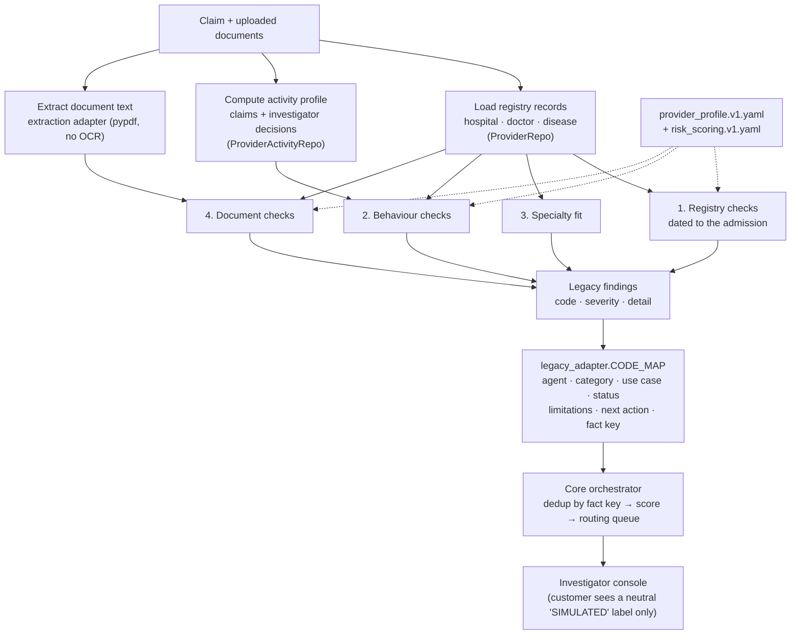
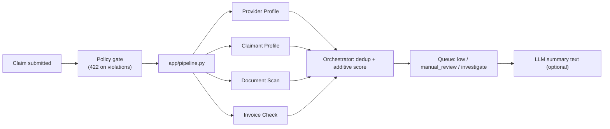

# Provider Profile agent

Code: `app/agents/provider_profile.py`. Spec mapping: the legacy module of the **Provider_Intelligence** agent (`design.md`), with findings mapped in `app/core/legacy_adapter.py`. Requirements: 15.5 and 15.10–15.14 in `.kiro/specs/claims-fraud-detection-service/requirements.md`.

## Summary

The agent checks whether the hospital and doctor on a claim are who and what they claim to be, on the date of treatment, and whether their recent behaviour looks unusual. It runs in parallel with the other three agents for every claim and returns findings. The orchestrator de-duplicates and scores those findings.

The agent has four groups of deterministic checks:

1. **Registry checks.** The claim is compared with the stored hospital and doctor records, read on the admission date: registration, licence and its expiry, affiliation and its dates, network membership period, GSTIN validity and state.
2. **Behaviour checks.** A profile is computed from claims data and investigator decisions: claim volume against baseline, amount outliers, peer cost comparison, flag rate, near-identical bills across patients, bed capacity, and the same doctor in another city on the same day.
3. **Specialty fit.** The doctor's specialty and the hospital's departments are compared with the diagnosis.
4. **Document checks.** The hospital name, GSTIN, doctor name and registration number printed on the uploaded documents are compared with the registry.

The agent makes **no LLM calls** (see [LLM usage](#llm-usage)). The registry is simulated seed data, so findings say "on record" and never "verified" (non-negotiable rule 4 in `AGENT_HANDOFF.md`).

## Workflow



Where it sits in the claim pipeline:



## Data sources

| Source | What the agent reads | Where |
|---|---|---|
| Hospital registry | name, city, address, registered flag, GSTIN, **state code**, specialties, **bed count**, **network period**, years active, registry averages (amount mean and spread, flag ratio, monthly baseline) | `providers` table → `ProviderRepo.hospital()` |
| Doctor registry | name, qualification, registration number, specialty, licence flag, **licence expiry**, affiliations with **start and end dates**, registry figures (claims per month, flag ratio) | `doctors`, `doctor_affiliations` → `ProviderRepo.doctor()` |
| Disease catalogue | name and the **specialties that treat it** | `app/seed/seed_data.py: DISEASES` |
| Claims data | processed claims at the hospital or by the doctor: submission dates, admission and discharge dates, amounts, diagnosis, claimant | `claims` → `ProviderActivityRepo` |
| Investigator decisions | latest decision per claim (`deny` and `REFER_TO_FIU` count as flagged) | `investigator_decisions` → `ProviderActivityRepo.decision_counts()` |
| Documents | text of each uploaded PDF | extraction adapter (`app/adapters/extraction/pypdf_ext.py`) |
| Thresholds | all limits below | `app/rules/provider_profile.v1.yaml`; volume multiple from `risk_scoring.v1.yaml` |

Fields in **bold** were added by migration `0003_provider_registry_fields`. A null value means "not on record", and the related check is skipped, not failed.

Activity queries count **earlier processed claims only**: status not `RECEIVED` or `POLICY_VIOLATION`, and never the claim being assessed. Re-assessing a claim therefore never compares it with itself.

## Checks

Points are what one finding adds to the claim score: severity points (low 10, medium 25, high 45) times the status multiplier (confirmed 1.0, potential anomaly 0.6, informational or inconclusive 0). "New" and "changed" refer to this change; see `docs/CHANGELOG.md`.

### 1. Registry checks (read on the admission date)

| Code | Severity | Status | Points | Fires when | |
|---|---|---|---|---|---|
| `HOSPITAL_UNKNOWN` | high | potential | 27 | the hospital id is not in the registry | |
| `HOSPITAL_UNREGISTERED` | high | confirmed | 45 | the registry marks the hospital as not registered | |
| `HOSPITAL_NEW` | low | informational | 0 | under `new_hospital_years` (2) of history | changed: threshold in config |
| `TAX_ID_MISMATCH` | high | confirmed | 45 | the GSTIN typed on the claim differs from the registry | changed: compared without case or separators |
| `REGISTRY_GSTIN_INVALID` | low | potential | 6 | the registry's own GSTIN fails the format or check-digit test | new |
| `GSTIN_STATE_MISMATCH` | medium | potential | 15 | the registry GSTIN's state code differs from the hospital's state | new |
| `HOSPITAL_NOT_EMPANELLED_ON_DATE` | medium | confirmed | 25 | the admission is outside the hospital's network period | new |
| `DOCTOR_UNKNOWN` | high | potential | 27 | the doctor id is not in the registry | |
| `DOCTOR_LICENSE_INVALID` | high | confirmed | 45 | the registry marks the licence invalid | |
| `DOCTOR_LICENCE_EXPIRED` | high | confirmed | 45 | the licence is valid but expired before the admission | new |
| `DOCTOR_REGISTRATION_MISSING` | low | potential | 6 | no council registration number is on record | new |
| `DOCTOR_NOT_AFFILIATED` | high | potential | 27 | the doctor is not linked to the claimed hospital | |
| `DOCTOR_AFFILIATION_INACTIVE` | high | potential | 27 | linked, but the affiliation dates do not cover the admission | new |
| `DOCTOR_MANY_HOSPITALS` | low | informational | 0 | `many_hospitals` (3) or more affiliations active on the admission date | changed: counts active affiliations only |

### 2. Behaviour checks (computed from claims data)

| Code | Severity | Status | Points | Fires when | |
|---|---|---|---|---|---|
| `HOSPITAL_HIGH_FRAUD_RATE` | medium | potential | 15 | the blended flag rate is above `fraud_rate.threshold` (20%) | changed: blended with decisions |
| `AMOUNT_OUTLIER_FOR_HOSPITAL` | medium | potential | 15 | the claim is more than `z_threshold` (2.0) standard deviations above the baseline | changed: computed baseline |
| `HOSPITAL_VOLUME_SURGE` (use case 65) | medium | potential | 15 | the hospital's claims in the last 30 days are more than 3× its baseline, with at least 5 claims | new |
| `PEER_COST_OUTLIER` | medium | potential | 15 | the claim is more than 2× the median for the diagnosis at other hospitals, with at least 8 peer claims | new |
| `HOSPITAL_OVER_CAPACITY` | medium | potential | 15 | stays overlapping the admission date, plus this claim, exceed the bed count | new |
| `DOCTOR_HIGH_FRAUD_RATE` | medium | potential | 15 | the doctor's blended flag rate is above 20% | changed: blended with decisions |
| `DOCTOR_HIGH_VOLUME` (use case 65) | medium | potential | 15 | max(registry claims per month, observed 30-day count) is above 150 | changed: uses observed volume |
| `DOCTOR_VOLUME_SURGE` (use case 65) | medium | potential | 15 | the doctor's claims in the last 30 days are more than 3× their registry monthly figure, with at least 5 claims | new |
| `DOCTOR_SIMILAR_BILLS` | medium | potential | 15 | 3 or more other patients of the doctor claimed within 2% of this amount in 90 days | new |
| `DOCTOR_SAME_DAY_OTHER_CITY` | medium | potential | 15 | the doctor has another admission on the same date at a hospital in another city | new |

How the computed values work (`app/core/provider_stats.py`):

- **Amount baseline:** the most specific source with enough data. First, the hospital's claims for the same diagnosis (at least 5). Then all of the hospital's claims (at least 10). Otherwise, the registry average and spread. The finding states which basis it used and how many claims. A computed spread is never below 10% of the mean, because package prices give near-identical amounts and a tiny spread would make any difference look extreme.
- **Flag rate:** `(registry rate × 10 + flagged decisions) / (10 + decided claims)`, over the last 365 days. The registry figure counts as 10 decisions, so a few decisions move the rate a little and many decisions dominate it. The finding says whether any decisions were used.
- **Volume:** the count of claims submitted in the 30 days up to the claim's submission date, against the registry monthly baseline scaled to the window.

### 3. Specialty fit

| Code | Severity | Status | Points | Fires when | |
|---|---|---|---|---|---|
| `DOCTOR_SPECIALTY_MISMATCH` | medium | potential | 15 | the doctor's specialty is not one of the diagnosis's `specialties` | new |
| `HOSPITAL_SPECIALTY_NOT_OFFERED` | medium | potential | 15 | none of the hospital's departments on record is one of the diagnosis's `specialties` | new |

### 4. Document checks (text from the extraction adapter)

| Code | Severity | Status | Points | Fires when | |
|---|---|---|---|---|---|
| `DOC_GSTIN_MISMATCH` | high | confirmed | 45 | a GSTIN printed on the documents is not the registry GSTIN | new |
| `DOC_HOSPITAL_NAME_MISMATCH` | high if another registered hospital is named, else medium | potential | 27 or 15 | the claimed hospital's name is not found on a document (fuzzy match below 0.8) | new |
| `DOC_DOCTOR_NAME_MISSING` | low | potential | 6 | the doctor's name is on none of the prescription and report (or on no document, if none is typed) | new |
| `DOC_DOCTOR_REG_MISMATCH` | high | potential | 27 | the documents show registration numbers, and none is the doctor's number on record | new |
| `PROVIDER_DOCS_NOT_CHECKED` | low | inconclusive | 0 | documents were uploaded but none has machine-readable text | new |

`DOC_GSTIN_MISMATCH` and `TAX_ID_MISMATCH` share a fact key (`tax_id_mismatch` for the same hospital), so a wrong GSTIN on both the bill and the form is **scored once**. An inconclusive finding adds no points. If the claim would otherwise be low risk, it marks the claim for human review. Name matching (`app/core/text_match.py`) ignores case, punctuation and titles such as "Dr.". It tries an exact match first, then a similarity ratio over word windows.

## Configuration

`app/rules/provider_profile.v1.yaml` (version `provider-2026.1`):

| Key | Default | Used by |
|---|---|---|
| `volume.window_days` / `volume.min_claims` | 30 / 5 | volume surges, observed doctor volume |
| `doctor_volume.high_per_month` | 150 | `DOCTOR_HIGH_VOLUME` |
| `amount_outlier.z_threshold` / `min_samples_disease` / `min_samples_hospital` | 2.0 / 5 / 10 | `AMOUNT_OUTLIER_FOR_HOSPITAL` |
| `peer_cost.min_peer_samples` / `multiple_of_peer_median` | 8 / 2.0 | `PEER_COST_OUTLIER` |
| `fraud_rate.threshold` / `prior_weight` / `flagged_decisions` / `window_days` | 0.2 / 10 / [deny, REFER_TO_FIU] / 365 | flag-rate checks |
| `similar_bills.window_days` / `tolerance_pct` / `min_other_claimants` | 90 / 2.0 / 3 | `DOCTOR_SIMILAR_BILLS` |
| `documents.name_match_threshold` | 0.8 | document name checks |
| `many_hospitals` / `new_hospital_years` | 3 / 2 | `DOCTOR_MANY_HOSPITALS`, `HOSPITAL_NEW` |
| `thresholds.provider_volume_multiple` (in `risk_scoring.v1.yaml`) | 3.0 | volume surges |

The file is validated with a strict Pydantic model (`app/core/provider_config.py`), so an unknown or misspelt key fails at load.

## LLM usage

**Every check above is deterministic code.** The LLM never decides a provider finding, the score or the queue.

When the console's **LLM analysis** switch is on (see [docs/llm_usage.md](../llm_usage.md)), each claim gets an LLM review of this agent after scoring:
- **What it gets:** the pseudonymised claim, this agent's rule findings and the lookup tools. In live runs it called `get_hospital_profile` and `get_doctor_profile`, and sometimes `get_disease_guidelines`.
- **Its focus:** the checks above, so it looks for what they cannot express. For example, a treatment this doctor or hospital is unlikely to perform even though the specialty matches.
- **What it returns:** up to 8 observations, capped at medium. They are shown in the console with an "LLM" tag and reasoning, and they add capped points as potential anomalies.
- **On failure:** if the output is invalid after one repair turn, or the provider fails after one retry, the agent keeps its rule result and shows "LLM review unavailable".

The investigator summary after scoring is also written by the LLM when the switch is on.

This follows rule 2 of `AGENT_HANDOFF.md`: matching, dates, arithmetic and thresholds are deterministic, and the LLM is for document understanding, semantic comparison and explanations.

**Planned LLM use for this agent** (after task 17 delivers the LLM adapter, the PII pseudonymiser and typed LLM tasks):

| Use | Input | LLM output (validated JSON) | What decides | Why it helps |
|---|---|---|---|---|
| 1. Provider identity extraction | document text or OCR of the letterhead, stamp, signature block | hospital name, address, GSTIN, doctor name, registration number, with page references | the document checks in group 4, unchanged | works on scans and varied layouts where regex fails |
| 2. Entity resolution | the extracted name and the registry record | same entity yes/no, with confidence | a configured confidence threshold | "City Genl. Hosp., Pune" or "Dr A. Rao" match without false mismatches |
| 3. Clinical capability fit | diagnosis, billed procedures, doctor specialty, hospital departments | plausible yes/no, with a reason | potential-anomaly finding, capped at medium | catches cases the static specialty table cannot, such as a general physician billing laparoscopic surgery |
| 4. Provider narrative | this agent's findings and the computed profile | short explanation and next steps | nothing (text only) | the investigator reads one paragraph instead of 10 rows |

Guardrails for every planned use:
- personal data is pseudonymised before the call
- document text is passed inside a delimited block as untrusted data, never instructions
- output must validate against a schema, otherwise the check is `NOT_CHECKED`
- LLM findings are capped at potential anomaly and medium, and never set the score or the queue
- every call is recorded in `llm_calls` without personal data
- with no key, the agent runs rules-only

## Example: the high-risk demo scenario

From `python scripts/provider_profile_demo.py` (fictional data):

```
high_risk: score 100.0 -> investigate
  low    HOSPITAL_NEW: Hospital has under 2 years of claim history.
  high   TAX_ID_MISMATCH: Tax ID on invoice does not match the hospital registry.
  low    DOCTOR_REGISTRATION_MISSING: No medical council registration number is on record for Dr. K. Mehta.
  medium HOSPITAL_HIGH_FRAUD_RATE: About 31% of this hospital's past claims were flagged (registry figure 31%; no investigator decisions yet).
  medium AMOUNT_OUTLIER_FOR_HOSPITAL: Claim is 17.9 standard deviations above the hospital average (31,250; all claims at this hospital, 32 claims).
  medium HOSPITAL_VOLUME_SURGE: 30 claims at this hospital in the last 30 days against a baseline of about 6 (over 3x).
  medium DOCTOR_HIGH_FRAUD_RATE: About 28% of this doctor's claims were flagged (registry figure 28%; no investigator decisions yet).
  medium DOCTOR_HIGH_VOLUME: Doctor appears on about 210 claims per month (registry figure 210, observed 0).
  high   DOC_GSTIN_MISMATCH: The documents show GSTIN 27AAACS2222B1Z9; the hospital's GSTIN on record is 27AAACS2222B1Z2.
```

## Limitations

- **Simulated registry.** All hospital and doctor records are synthetic seed data. Nothing is confirmed with a medical council, a facility registry or GSTN, so findings say "on record".
- **No OCR.** Document checks need machine-readable PDF text. Photos and scans give `PROVIDER_DOCS_NOT_CHECKED`.
- **Pattern matching.** GSTINs and registration numbers are found by pattern, so an unusual registration format may be missed.
- **This insurer's claims only.** Volume, capacity and same-day checks count this insurer's claims. A hospital's admissions with other payers are invisible.
- **Seeded history.** The demo has little real history, so peer comparisons and per-diagnosis baselines usually fall back to registry figures. The finding says so.
- **Static specialties.** The diagnosis-to-specialty table is small and static (`DISEASES[...].specialties`).
- **Doctor volume.** `DOCTOR_HIGH_VOLUME` and `DOCTOR_VOLUME_SURGE` measure claims linked to the doctor. The seeded surge claims at H002 have no doctor, so the observed doctor volume there is 0.

## How to verify

| Command | What it shows |
|---|---|
| `python scripts/provider_profile_demo.py` | each demo scenario's provider findings and score, plus one targeted case per new check (19 cases, prints PASS or FAIL) |
| `python -m pytest -q` | full suite, including the finding-mapping test, which covers every code above |

Local database: migration `0003` adds columns. The development server creates tables with `create_all`, which does not add columns to an existing SQLite file, so delete `claims_fraud.db` once to re-create and re-seed it. With Alembic, run `alembic upgrade head` and re-run `python -m app.seed.run`; the seed fills the new columns on existing rows.

## Files

| File | Role |
|---|---|
| `app/agents/provider_profile.py` | the agent: four check groups |
| `app/core/provider_stats.py` | baselines, z-score, blended rate, surge test (pure) |
| `app/core/text_match.py` | name matching, GSTIN and registration-number extraction (pure) |
| `app/core/provider_config.py`, `app/rules/provider_profile.v1.yaml` | thresholds |
| `app/db/repos.py` | `ProviderRepo` (registry fields) and `ProviderActivityRepo` (claims-data queries) |
| `app/db/models.py`, `app/db/alembic/versions/0003_provider_registry_fields.py` | new registry columns |
| `app/seed/seed_data.py`, `app/seed/run.py` | seeded registry values and disease specialties |
| `app/core/legacy_adapter.py` | finding mapping (category, use case, status, limitations, next action) |
| `app/catalog.py` | the console's check list |
| `scripts/provider_profile_demo.py` | demonstration and verification script |
