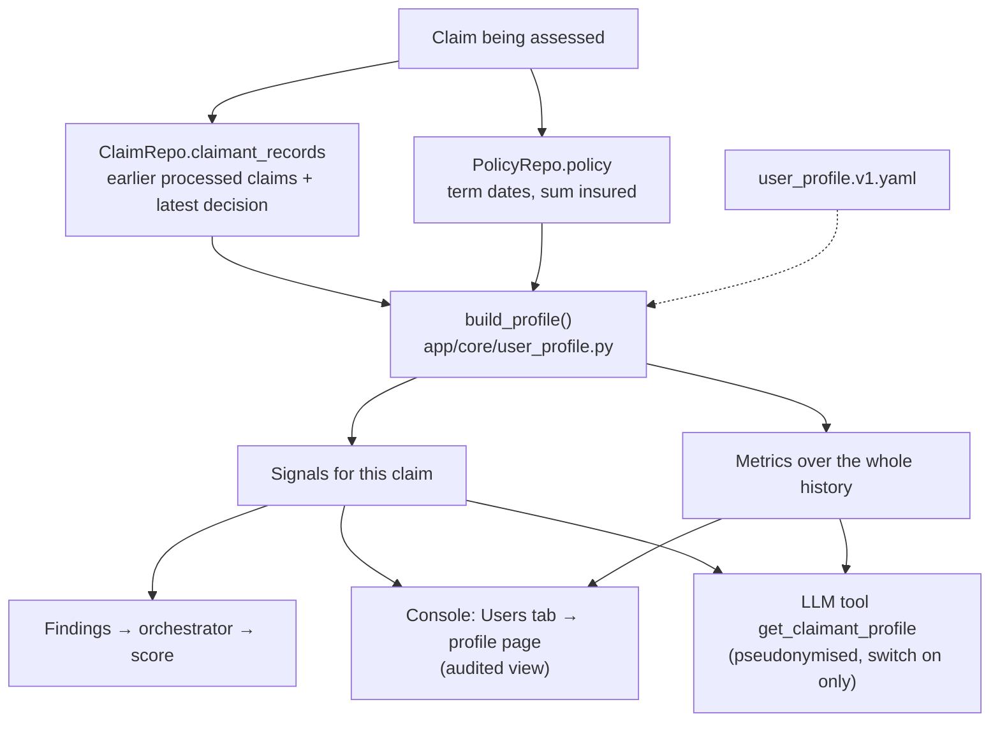

# User Profile agent (claimant profile)

Code: `app/agents/claimant_profile.py` (agent id `claimant_profile`, shown as "User Profile Agent"). Profile logic: `app/core/user_profile.py`, shared with the investigator page. Thresholds: `app/rules/user_profile.v1.yaml`. Findings map to **Customer_Behaviour** (re-claimed stays to **Duplicate_Detection**) in `app/core/legacy_adapter.py`.

## Summary

The agent builds the policyholder's profile from every earlier processed claim:
- stay dates, amount, hospital, doctor and diagnosis
- the latest investigator decision on each claim
- the policy's terms and sum insured

It then checks the claim being assessed against that profile. The same profile drives the **User profile page** in the console, so a colleague investigating a claim can see the person's whole history in one place.

## Workflow

## Checks

Points: severity points (low 10, medium 25, high 45) × status (potential anomaly 0.6, confirmed 1.0).

| Group | Code | Severity | Fires when | |
|---|---|---|---|---|
| Earlier claims | `CLAIM_FREQUENCY` / `CLAIM_FREQUENCY_EXTREME` | medium / high | 2 / 4 or more other claims in the last 90 days | |
| | `AMOUNT_SPIKE` | medium | claim above 3× the claimant's average | |
| | `AMOUNT_ESCALATION` | medium | each of the last 3 claims is at least 1.2× the one before | new |
| | `REPEATED_SIMILAR_AMOUNTS` | medium | 3+ claims within 10% of each other | |
| | `HOSPITAL_HOPPING` | medium | 3+ different hospitals in earlier claims | |
| Re-claiming | `RESUBMITTED_STAY` | high | an earlier claim at the same hospital covers the same stay | new |
| | `OVERLAPPING_STAYS_ELSEWHERE` | medium | the stay overlaps an earlier claim at another hospital | new |
| Earlier fraud | `PRIOR_FRAUD_DECISION` | high | an earlier claim's latest decision is `deny` or `REFER_TO_FIU` | new |
| Submission behaviour | `DATES_INVALID` | high | discharge before admission (confirmed) | |
| | `LATE_SUBMISSION` | low | submitted over 90 days after discharge | |
| | `HIGH_AMOUNT_SHORT_STAY` | medium | over 1,00,000 for a stay of a day or less | |
| Policy timing | `CLAIM_SOON_AFTER_POLICY_START` | medium | admission within 30 days of policy inception | new |
| | `CLAIM_NEAR_POLICY_END` | low | admission in the last 30 days of a policy term | new |
| | `POLICY_END_PATTERN` | medium | 2+ claims (including this one) in the last 30 days of a term | new |
| | `SUM_INSURED_NEAR_LIMIT` | low | claims in the current term reach 80% of the sum insured | new |

Policy terms repeat yearly from the policy dates, so the "near term end" checks work across renewals. Only processed claims count as history, and never the claim being assessed.

## User profile page

Console → **Users** tab, or **User profile** on any claim.

- **List:** search by claimant id, name or policy. Shows claims, total claimed, last claim, earlier denied or referred claims, and signals on the latest claim.
- **Profile:**
  - identity, policy and term
  - claimed amount against the sum insured
  - metrics: claims, total and average, largest claim, last 90 days, hospitals, average days from discharge to claim, claims near a term end
  - behaviour signals and investigator outcomes
  - a timeline of every claim: hospital, doctor, diagnosis, stay, submission lag, a "days before term end" marker, decision, and the console queue and score with a link to the claim
- **Access:** all console roles. Each view is audited as `claimant_access`.
- **API:** `GET /api/internal/claimants?q=` and `GET /api/internal/claimants/{claimant_id}` (`app/api/claimants.py`).

## LLM usage

It runs only when the console's **LLM analysis** switch is on ([docs/llm_usage.md](../llm_usage.md)).

- **When:** after scoring, the agent's rule findings and the pseudonymised claim go to Gemini.
- **Tool:** `get_claimant_profile`. It returns the claims (dates, amount, hospital and doctor ids, diagnosis, decision), the metrics and the signals. It **never** returns the name, date of birth or real claimant or policy id; the claimant is `CLAIMANT-1`, and the tool only answers for the claimant of this claim.
- **What it looks for:** patterns the rules cannot express, such as a sequence of claims that together look staged, or a diagnosis history that does not fit the treatments. Live example: `RECURRING_DIAGNOSIS_PATTERN`, "repeated viral fever claims at the same hospital".
- **Effect:** observations are shown with an "LLM" tag and add capped points as potential anomalies. Any echo of the claimant's name in the reply is scrubbed (none was seen in testing).

## Seed data for the demo

- `HISTORY_DETAILS` in `app/seed/seed_data.py` adds stay dates, diagnosis and an investigator decision to the history claims.
- C-202 (R. Singh, U002) is **denied**, so U002's new claims get `PRIOR_FRAUD_DECISION`.
- Seeded decisions belong to an inactive `system` user that cannot log in.
- After changing seed data, use **Reset demo data** in the console.

## Verified

- **Tests:** role matrix, seeded repositories, seed and scenarios, finding mappings and defect regressions all pass (202 tests; targeted run only).
- **Live run:**
  - user list and profile load
  - the suspicious demo claim (U002) gives `PRIOR_FRAUD_DECISION`, `SUM_INSURED_NEAR_LIMIT`, `CLAIM_FREQUENCY` and `HIGH_AMOUNT_SHORT_STAY`
  - the LLM called `get_claimant_profile(claimant_id='CLAIMANT-1')` and added one observation
  - the claimant name did not appear in the tool calls or the reasoning

## Limitations

- **This insurer only:** the history covers this insurer's claims, and decisions are those recorded in the console.
- **Re-claim detection:** it needs stay dates, so older claims without them can't match.
- **Policy dates:** the start-of-policy check uses the current policy's start date, not an earlier insurer's.
