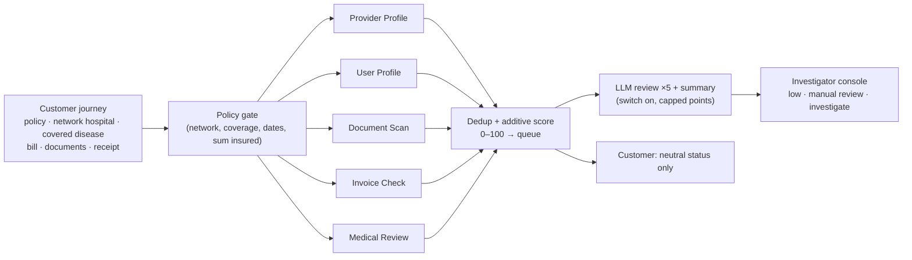

# ClaimShield: the agents (presentation brief)

## 1. The one-minute pitch

When a health claim is submitted, **five AI-assisted agents** check it **in parallel**:

| Agent | Question it answers |
|---|---|
| Provider Profile | Is the **hospital and doctor** legitimate on that date? |
| User Profile | Does the **policyholder's history** look unusual? |
| Document Scan | Are the **documents** genuine, unedited and consistent? |
| Invoice Check | Is the **bill** correct, unique, GST-valid and actually **paid**? |
| Medical Review | Do the **ICD codes, medicines, lab report and treatment** fit the diagnosis, and is the lab report untampered? |

- **Score:** deterministic rules produce findings and an explainable 0–100 risk score.
- **LLM:** an optional LLM (Gemini) reviews each agent's result and adds observations and a summary for investigators. **Its findings add capped points to the score (at most 15 per agent and 25 per claim), so the rules stay the main signal.**
- **People decide:** a human investigator makes every final decision; the system never rejects a claim.

## 2. How a claim flows

- **Scoring:** each finding contributes severity points (low 10, medium 25, high 45) × status (confirmed 1.0, potential anomaly 0.6). The total is capped at 100, and the same fact is counted once.
- **Queues:** below 30 low risk, 30–59 manual review, 60 and above investigate.
- **Speed:** rules-only takes under a second per claim; with the LLM, about 5–25 seconds.

## 3. The agents

### Agent 1: Provider Profile ("is the hospital and doctor legitimate on that date?")
| Area | Checks (examples) |
|---|---|
| Registry, read **on the admission date** | unregistered hospital, outside its network period, GSTIN invalid or from the wrong state, licence invalid or **expired**, no registration number, doctor not affiliated or **affiliation ended** |
| Behaviour **computed from claims data** | hospital or doctor **volume surge** (use case 65), amount outlier against the hospital's own claims for the same diagnosis, **peer hospital** cost outlier, fraud rate **learned from investigator decisions**, near-identical bills across a doctor's patients, **more admissions than beds**, **same doctor in another city on the same day** |
| Specialty fit | an orthopaedic surgeon billing an appendectomy; a hospital without the department |
| Documents against the registry | hospital name, GSTIN, doctor name and registration number printed on the PDFs |
| **LLM** | looks up hospital and doctor profiles and judges plausibility beyond the rules, for example a treatment this doctor or hospital is unlikely to perform |

31 checks · data: `providers`, `doctors`, `doctor_affiliations`, claims, decisions · thresholds in `provider_profile.v1.yaml`.

### Agent 2: User Profile ("does the policyholder's behaviour look unusual?")
| Area | Checks (examples) |
|---|---|
| Earlier claims | frequency (2 or more in 90 days), amount spike (above 3× average), **escalating amounts**, near-identical amounts, many hospitals |
| Re-claiming | **same stay claimed again**, stays overlapping at another hospital |
| Policy timing | claim **within 30 days of policy start**, **near a term end**, a **pattern** of claims near term ends, sum insured nearly used up |
| Earlier fraud | an earlier claim **denied or referred to the fraud unit** by an investigator |
| Submission | late submission, high amount for a one-day stay, invalid dates |
| **Profile page** | console **Users** tab: the person's full history, metrics, signals, outcomes and timeline. Viewing it is audited |
| **LLM** | reads the profile as `CLAIMANT-1` (no name, date of birth or real IDs) and looks for patterns across claims, for example repeated viral-fever claims at the same hospital |

16 checks · thresholds in `user_profile.v1.yaml`.

### Agent 3: Document Scan ("are the documents genuine and consistent?")
| Area | Checks (examples) |
|---|---|
| Completeness and file | missing bill or report, wrong type, unreadable, **file reused** from another claim (hash) |
| Metadata | editing software (Photoshop, Canva, Word), modified long after creation, bill file created before admission, metadata stripped |
| **Changed after generation** | the PDF has **more than one saved revision**; the bill was modified after its bill date |
| **AI-generated** | AI-tool markers in metadata (ChatGPT, DALL·E, Midjourney, Firefly, Canva Magic Design, "trainedAlgorithmicMedia") |
| **Content against the claim** | printed patient, policy, admission and discharge dates, diagnosis, bill number, total and date differ from the claim |
| **LLM** | reads document text **with personal data redacted** and judges authenticity: AI or templated wording, a report that doesn't support the bill, contradictions, unusual details |

21 checks · every indicator is a *potential* anomaly (at most medium) with alternative explanations.

### Agent 4: Invoice Check ("is the bill correct, unique, GST-valid and paid?")
| Area | Checks (examples) |
|---|---|
| Arithmetic and plausibility | line items against the total, claimed against the bill, round totals, repeated items, cost and stay against what's typical for the diagnosis |
| **GST** | GSTIN **check digit**, GST charged without a GSTIN, CGST and SGST not equal halves, mixed IGST, GST on exempt treatment. *A missing GSTIN is not flagged: most healthcare is GST-exempt* |
| **Duplicates** | exact repeat, **same number formatted differently**, **same bill under a new number** (same date and total), same number at another hospital |
| **Payment** | **cashless/TPA bill claimed as a reimbursement**, balance still due, **claimed above amount paid**, no proof of payment, payment date outside the stay. Customers can upload an optional receipt |
| **LLM** | sees only bill details (numbers, dates, GST, payment) and judges charges, for example ₹1,00,000 in consultations for one night with fever |

23 checks.

### Agent 5: Medical Review ("do the diagnosis, medicines, lab report and treatment agree?")
| Area | Checks (examples) |
|---|---|
| **ICD-10** | code missing, invalid, not matching the diagnosis, or different across documents |
| **Medicines** | a medicine not indicated for the diagnosis, unrelated, or the usual medicine missing |
| **Lab report tampering** | the report number identifies the lab; a verification code over number, date, policy and results must match the lab registry (simulated). An edited result fails |
| **Treatment** | the billed procedure does not fit the diagnosis (for example a wrong-disease procedure), or the usual treatment is absent |
| **LLM** | reads redacted text, the clinical reference and the lab verification result, and judges doses, combinations and results against the diagnosis |

16 checks · reference data in `medical_reference.v1.yaml` (illustrative, not medical advice).

## 4. How the LLM is used (governance)

| Topic | Answer |
|---|---|
| What it does | (1) reviews each agent's result with lookup tools, adding up to 5 observations and reasoning; (2) writes the investigator summary |
| What it doesn't do | raise a confirmed violation. Observations count as potential anomalies and add capped points (15 per agent, 25 per claim, below the manual-review band of 30) |
| Model | Google Gemini (`gemini-3.5-flash-lite`, with fallbacks to two other models) |
| On/off | the **LLM analysis switch** in the console header: Administrator only, stored on the server, audited, read once per claim at submission. No API key means it's off. Customers can't change it |
| Personal data | names removed; claimant ID and policy number pseudonymised (`CLAIMANT-1`, `POLICY-1`); document text redacted (name, policy, IDs, phone numbers, e-mails, date of birth, Aadhaar-like and PAN-like numbers). Live tests found no personal data in the LLM output |
| Prompt injection | claim data and document text are marked as untrusted data; the model is told to ignore instructions inside them |
| Output safety | strict JSON schema with one repair attempt; up to 3 attempts when Gemini is busy; falls back to rules on failure |
| Audit | every call is logged in `llm_calls`: model, prompt version, **field names only**, outcome |
| Tools available | hospital profile, doctor profile, claimant profile, claimant history, document metadata, **document text (redacted)**, **bill details**, disease guidelines, policy details |

## 5. Demo script (5 minutes)

1. **Journey:** open `/?demo=1`, click **Genuine claim**, submit. The loading page shows each check, with an "AI review" badge. The report shows a neutral status.
2. Repeat with **Suspicious claim**.
3. **Console:** open `/internal` and sign in as `investigator`. Under **Claims**, open the suspicious claim and show:
   - the score (100) and why it was decided
   - the timeline, showing the agents ran in parallel
   - each agent's rule findings, its purple **LLM** observations with reasoning, and the tools called
4. Click **User profile**. R. Singh has an earlier **denied** claim, frequent claims and a profile timeline.
5. **Workflow** and **Agents** tabs: the architecture and all check codes.
6. Sign in as `admin` and toggle **LLM analysis** off. Submit again: the claim is rules-only and the score is the same.

| Demo case | Score | Key findings |
|---|---|---|
| Genuine | 0 → low | none |
| Suspicious | 100 → investigate | duplicate invoice, cashless and unpaid bill, Photoshop and a second PDF revision, earlier fraud decision, volume surge, consultation charges far above typical |
| Fabricated | 100 → investigate | AI-tool marker (Canva Magic Design), invalid licence, round total |
| Borderline | 36 → manual review | missing discharge summary, amount outlier |

## 6. Likely questions and answers

- **Why not let the AI decide?** Regulators and investigators need reproducible, explainable decisions. Rules give exact, auditable results. The LLM adds judgement on semantics and explanation, and a human decides.
- **Can the LLM increase someone's risk score?** Yes, within limits. Each LLM finding adds points as a potential anomaly, capped at 15 per agent and 25 per claim. The LLM alone cannot move a claim to manual review (30). The score shows rules + LLM separately.
- **How do you protect personal data?** Pseudonyms, redaction, a minimal field set, no personal data in logs or LLM call records, and staff-only role-based access with audited profile views. Customers never see scores or findings.
- **What if Gemini is down or returns nonsense?** Strict schema validation, one repair attempt, retries and model fallback. If all of that fails, the agent keeps its rule result and shows "LLM review unavailable".
- **How do you detect an edited bill?** Editing-software metadata, a second saved PDF revision, a modification date after the bill date, and printed totals or numbers that differ from the claim.
- **How do you detect AI-generated documents?** AI-tool markers in metadata (rules), plus an LLM reading the redacted text for templated or implausible content. We're explicit that the absence of a marker proves nothing.
- **How do you know a bill was paid?** The bill's payment block (mode, amount paid, balance due, receipt number, date) and an optional receipt upload. A cashless or TPA bill claimed as a reimbursement is flagged as possible double recovery.
- **How do you catch duplicate bills?** Exact number, normalised number, the same date and total under a new number, the same file hash, and a stay claimed twice.
- **Does it learn?** Provider fraud rates blend the registry figure with investigator decisions (`deny` or `REFER_TO_FIU`). The User Profile flags people with earlier denied claims.
- **Is the registry real?** No. It's synthetic seed data labelled SIMULATED, so findings say "on record", never "verified". Real registries (the National Medical Commission's register, the national health facility registry, GSTN) would plug in behind adapters.
- **How do you tune it?** YAML thresholds per agent (`app/rules/*.yaml`) and the risk configuration (points, multipliers, bands), all versioned.
- **How does it scale?** Agents are independent and run in parallel. Persistence is SQLite now and PostgreSQL-ready, behind adapters, with AWS (Bedrock, Textract, S3, SQS) as the target.

## 7. Honest limitations (say these before you're asked)

- No OCR yet: scanned images skip the content checks.
- No visual tampering analysis (fonts, stamps, signatures).
- GSTIN check is format and check digit only, with no live GSTN lookup.
- Registry and history are synthetic, and the demo history is small, so peer comparisons often fall back to registry figures.
- Claim processing state is in memory today; the queue and worker are planned (task 15).
- Receipt numbers aren't yet checked across claims.

## 8. Numbers to quote

- **5 agents, 107 rule checks** (31 + 16 + 21 + 23 + 16), each mapped to a fraud category and use case
- **11 LLM lookup tools**, at most 25 points of LLM influence on the score
- **473 automated tests** in the last full run, plus targeted runs after each change
- **Per claim:** rules under 1 second; with the LLM, about 5–25 seconds and 6 Gemini calls (5 reviews and 1 summary)
